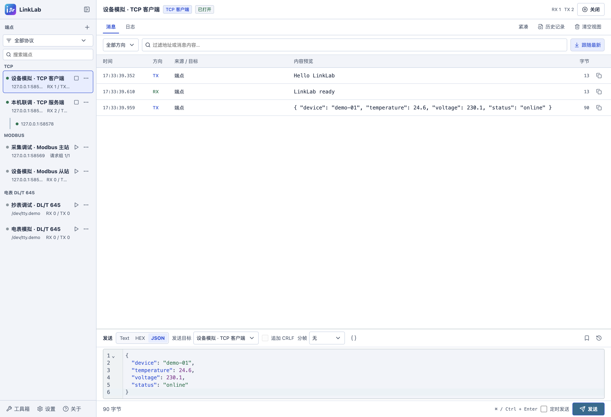
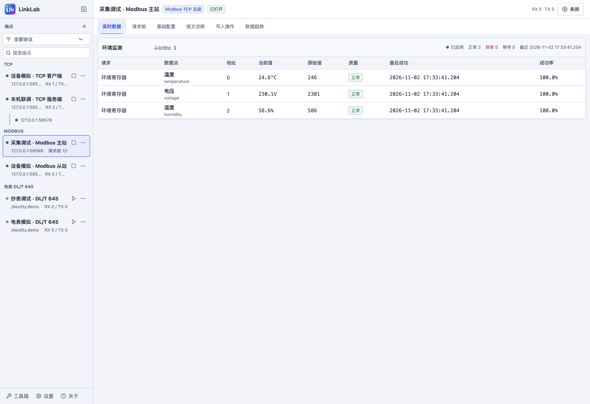
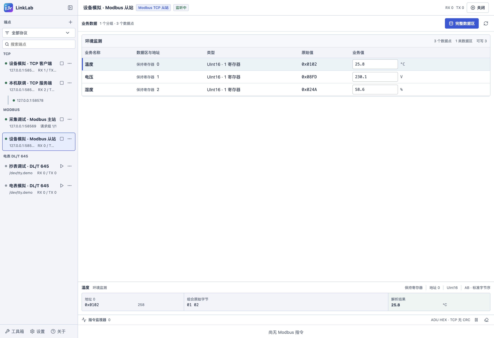

<p align="center"></p>

# Ineed LinkLab

[简体中文](README.md) · English

**An open-source serial port monitor and industrial protocol debugging tool.** Test serial, TCP/UDP, Modbus TCP/RTU, OPC UA, WebSocket, STOMP and DL/T 645 devices in one desktop workbench. Create multiple endpoints, connect clients to test servers, and save device templates and acceptance checks for repeatable commissioning.

[Website](https://linklab.ineedfull.com/) · [Downloads](https://linklab.ineedfull.com/downloads/) · [GitHub](https://github.com/ineedfull/ineed-linklab) · [Gitee](https://gitee.com/ineedfull/ineed-linklab)

[](docs/images/readme/workbench.webp)

## Protocols and roles

| Protocol | Available operations |
| --- | --- |
| Serial port | Configure the port, frame incoming bytes, send and inspect text or binary data. |
| TCP / UDP | Create client and server endpoints, debug multiple connections, and inspect messages and history. |
| Modbus TCP / RTU | Read and write registers as a master, simulate slave devices, decode business values, and [simulate changing values](docs/modbus-simulation.md). |
| DL/T 645 | Read electricity meters, simulate a meter, and diagnose frames and data items. |
| OPC UA | Discover servers, manage certificate trust, read/write/subscribe, and run a [simulator with changing nodes](docs/opcua-simulator.md). |
| WebSocket | Test clients and servers with text/JSON/binary messages, Ping/Pong and reconnection. |
| STOMP over WebSocket | Test STOMP 1.2 subscriptions, topic/queue destinations, ACK/NACK and receipts using a client or test server. |

Simulators are intended for device integration and local testing. Protocol coverage and limits are documented in the [OPC UA](docs/opcua-workbench.md), [WebSocket](docs/websocket-workbench.md) and [STOMP](docs/stomp-workbench.md) guides; the STOMP test server is not a production broker.

## From a frame to an acceptance report

- **Inspect traffic:** manage independent endpoints, messages, logs and history in a shared Electron / Tauri workbench.
- **Convert industrial data:** use the offline [toolbox](docs/industrial-toolbox.md) for ASCII/HEX, BCD, number bases, signed integers, IEEE floating point, byte/word order, bit masks and CRC/SUM/XOR/LRC checksums.
- **Reuse device models:** save versioned [device templates](docs/device-templates.md), preview an import, and create an instance with the target device address.
- **Repeat read-only acceptance checks:** save Modbus / OPC UA checks and export JSON or Markdown reports with observed values and evidence.

## Screenshots

These screenshots show the Chinese interface in an isolated Electron development environment. See the [Chinese README](README.md#界面预览) for dates and more views. Click an image to enlarge it.

| Live Modbus values | Simulated Modbus slave |
| --- | --- |
| [](docs/images/readme/modbus-live.webp) | [](docs/images/readme/modbus-simulator.webp) |

## Get started

1. Choose a desktop package from the [download page](https://linklab.ineedfull.com/downloads/).
2. Create an endpoint and select the protocol and connection parameters.
3. Connect to a local test peer or an authorized device, then inspect traffic and decoded values.
4. Open the toolbox to convert data, manage templates or run acceptance checks.

Electron and Tauri share the UI and domain logic. Electron bundles Chromium and generally uses more disk space and memory. Package availability, signing status and platform verification are documented in the download page and [packaging guide](docs/desktop-packaging.md).

## Run from source

Use Node.js 26 as specified by `.nvmrc`, npm and the repository lockfile:

```sh
npm ci
npm run dev:electron
```

For the native Tauri application, install Rust and the system dependencies described in the [development guide](docs/development.md), then run `npm run dev:tauri`.

```sh
npm test
npm run lint
npm run build
```

Modbus RTU pseudo-terminal tests on macOS / Linux require `socat`. See the development guide for the complete native test prerequisites. The detailed product guides are currently in Chinese.

## Contribute and license

See [CONTRIBUTING](CONTRIBUTING.md), the [code of conduct](CODE_OF_CONDUCT.md) and [security reporting](SECURITY.md). Please include the OS, version and reproduction steps in reports, and remove credentials and sensitive device data.

Original project source is licensed under [Apache-2.0](LICENSE), except where another license is specified. See [NOTICE](NOTICE) and [third-party notices](THIRD_PARTY_NOTICES.md). Product names and logos are not licensed as trademarks by the source license. Contact: [xiaopanghhh@163.com](mailto:xiaopanghhh@163.com).

## More Ineed tools

| Tool | Purpose | Website | Source |
| --- | --- | --- | --- |
| MQTT Tool | MQTT client with independent JSON/Text/HEX views per subscription and message scenario tests | [Website](https://mqtt.ineedfull.com/) | [GitHub](https://github.com/ineedfull/ineed-mqtt-tool) · [Gitee](https://gitee.com/ineedfull/ineed-mqtt-tool) |
| LinkLab | Serial and industrial protocol testing, simulators and device acceptance | [Website](https://linklab.ineedfull.com/) | [GitHub](https://github.com/ineedfull/ineed-linklab) · [Gitee](https://gitee.com/ineedfull/ineed-linklab) |
| NetTool | IP address management, network planning, diagnostics and project handover | [Website](https://nettool.ineedfull.com/) | [GitHub](https://github.com/ineedfull/ineed-net-tool) · [Gitee](https://gitee.com/ineedfull/ineed-net-tool) |
| StorageLab | MinIO/S3 and multi-provider object storage management with directory verification | [Website](https://storagelab.ineedfull.com/) | [GitHub](https://github.com/ineedfull/ineed-storagelab) · [Gitee](https://gitee.com/ineedfull/ineed-storagelab) |

Ineed: [www.ineedfull.com](https://www.ineedfull.com/).
