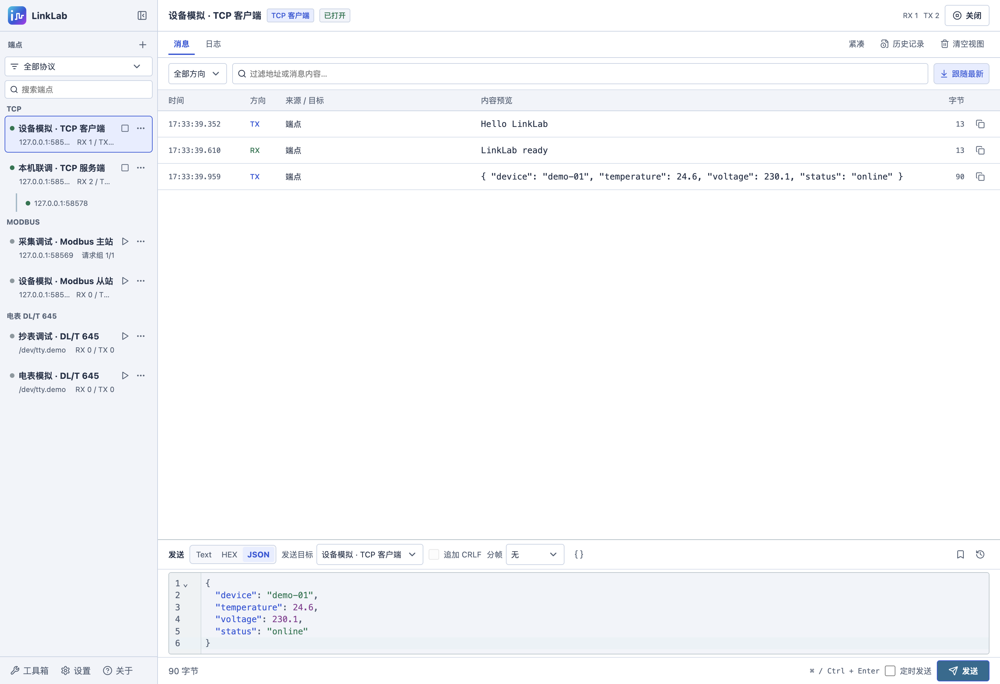
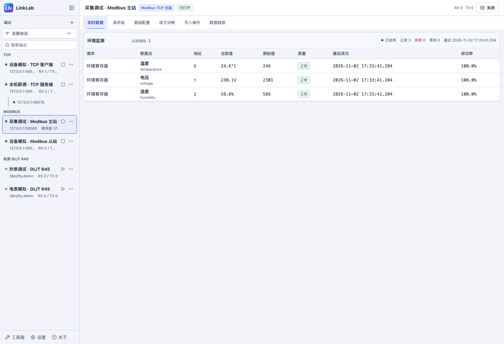
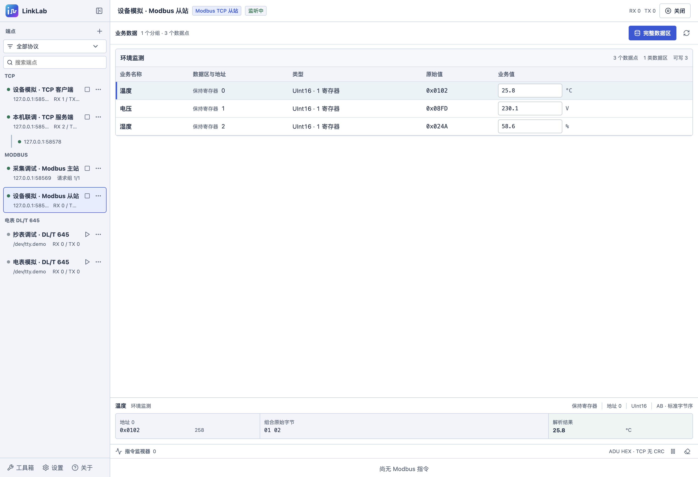
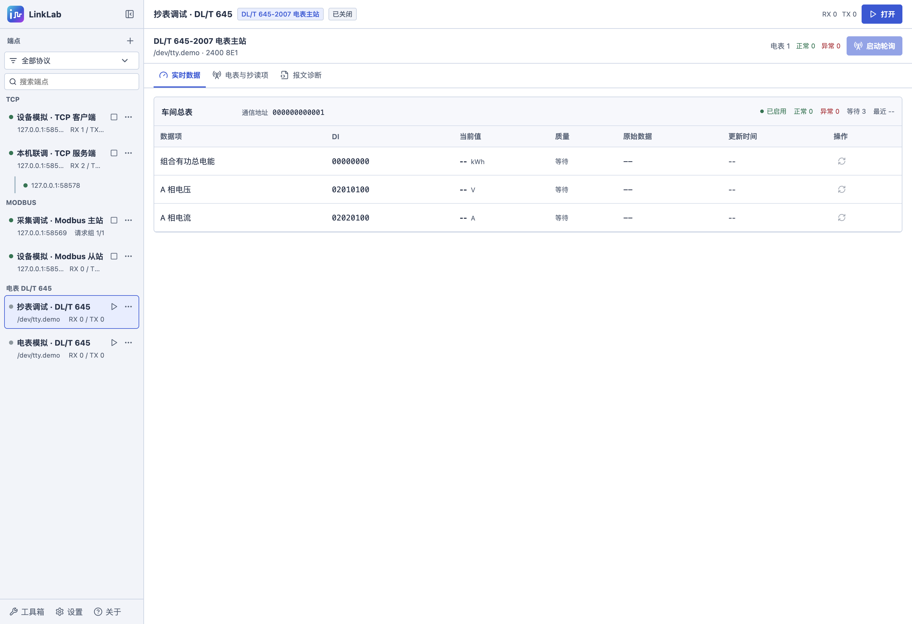
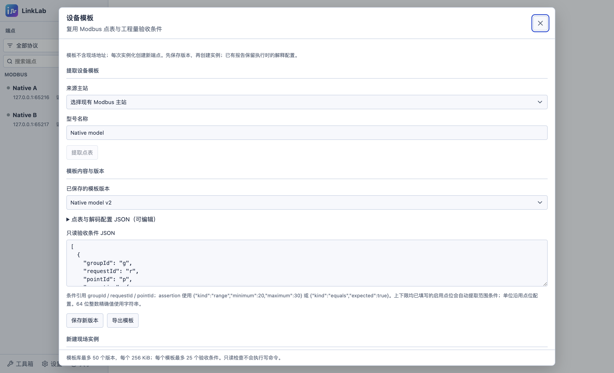
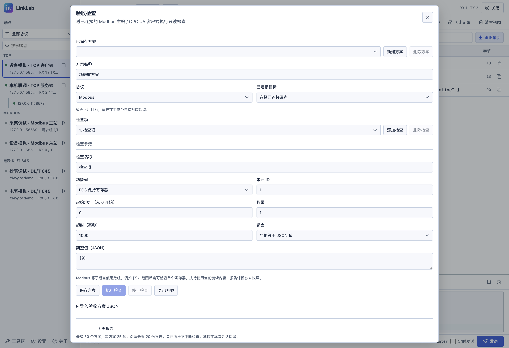
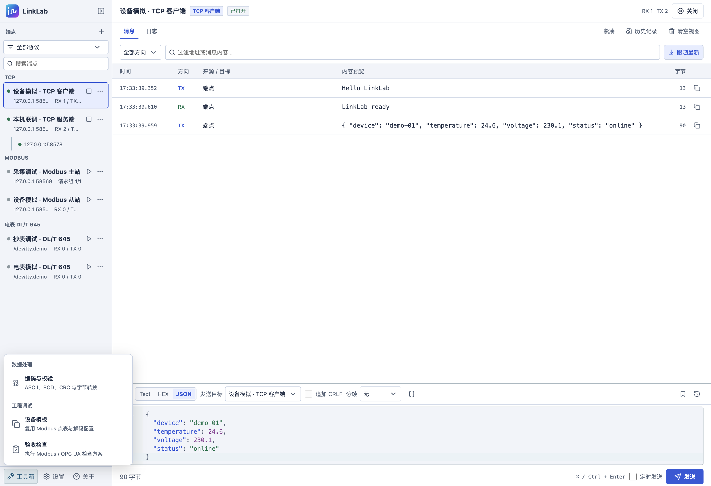

<p align="center"></p>

# Ineed LinkLab

简体中文 · [English](README.en.md)

**开源串口调试助手与工业协议测试工具。** 支持串口、TCP/UDP、Modbus TCP/RTU、OPC UA、WebSocket、STOMP 和 DL/T 645。在同一个桌面工作台创建多个端点，进行客户端与模拟服务端互测，再把设备模板和验收步骤保存下来，便于现场联调与重复验证。

[产品官网](https://linklab.ineedfull.com/) · [下载安装](https://linklab.ineedfull.com/downloads/) · [设备模板](docs/device-templates.md) · [开发指南](docs/development.md) · [快速上手](docs/quick-start.md)

[](docs/images/readme/workbench.webp)

## 协议与角色

| 协议 | 可用角色与主要操作 |
| --- | --- |
| 串口 | 参数配置、接收分帧、文本与二进制收发 |
| TCP / UDP | 客户端与服务端端点，多连接调试、日志与历史 |
| Modbus TCP / RTU | 主站采集与写入、从站模拟、寄存器与业务点位解码、[数值自动变化](docs/modbus-simulation.md) |
| DL/T 645 | 电表抄读与模拟电表，数据项解析和报文诊断 |
| OPC UA | 客户端发现、证书信任、读写与订阅；模拟服务端与可变节点 |
| WebSocket | 客户端与服务端，文本/JSON/二进制、Ping/Pong 与重连 |
| STOMP over WebSocket | STOMP 1.2 客户端与测试服务端，订阅、topic/queue、ACK/NACK 与 receipt |

模拟服务端适合联调，具体协议范围与限制见下方各协议指南；STOMP 测试服务端的能力不等于生产消息代理。

## 从报文到设备验收

- **统一端点工作台**：多端点独立配置，查看收发、日志和历史；Electron / Tauri 共用界面与领域逻辑。
- **工业编码与校验**：工具箱提供 ASCII/HEX、BCD、进制与补码、整数、IEEE 浮点、字节/字序、位掩码、CRC、SUM/XOR/LRC 九类离线工具。
- **复用设备模板**：从 Modbus 配置提取模型，保留版本、预览导入，再创建具有现场地址的新实例。
- **执行只读验收**：将 Modbus / OPC UA 检查保存为方案，比较实际值并导出 JSON/Markdown 证据报告。
- **保持操作习惯**：浅色/深色、大字模式、侧栏折叠，以及统一的端点表单与参数分组。

## 界面预览

以下截图来自 2026-11-02 的 Electron 原生开发宿主，使用隔离演示数据与本机服务。点击图片查看原图。

| Modbus 实时业务点位 | Modbus 从站模拟 |
| --- | --- |
| [](docs/images/readme/modbus-live.webp) | [](docs/images/readme/modbus-simulator.webp) |

| DL/T 645 电表抄读 | 设备模板与版本 |
| --- | --- |
| [](docs/images/readme/meter-master.webp) | [](docs/images/readme/device-templates.webp) |

| 只读验收方案 | 工具箱统一入口 |
| --- | --- |
| [](docs/images/readme/acceptance-checks.webp) | [](docs/images/readme/workspace-tools.webp) |


## 开始使用

本轮测试版：`0.1.1`，调整范围见[版本说明](docs/releases/2026-11-20.md)。已可下载的文件及构建标识以官网下载页为准。

第一次使用？先按[快速上手](docs/quick-start.md)完成一个小练习，里面列出了示例参数、成功判断和常见问题排查。

1. 安装桌面版，选择「新建端点」并填写协议参数。
2. 联调本机客户端与服务端，或打开已经授权的设备连接。
3. 在实时消息、业务点位与报文诊断之间核对结果。
4. 从左下角「工具箱」进入编码与校验、设备模板或验收检查。

Electron / Tauri 均有桌面实现。Electron 通常占用更多内存与磁盘；两端功能使用同一套工作台。安装规格及平台实机验证以官网和[打包说明](docs/desktop-packaging.md)为准。

## 从源码运行

使用 `.nvmrc` 指定的 Node.js 26，依赖由 npm 与 `package-lock.json` 维护。在仓库根目录执行：

```sh
npm ci
npm run dev:electron
```

Tauri 需要 Rust 与系统开发依赖，准备后执行 `npm run dev:tauri` 启动真实桌面。依赖下载镜像、浏览器安装与原生前提见[开发指南](docs/development.md)。

```sh
npm test
npm run lint
npm run build
```

macOS / Linux 的测试包含真实 Modbus RTU 伪终端回归，需要安装 `socat`。

## 文档导航

| 想了解什么 | 入口 |
| --- | --- |
| 工业数据转换与校验 | [工业工具箱](docs/industrial-toolbox.md) |
| OPC UA 客户端与模拟服务端 | [客户端](docs/opcua-workbench.md)、[模拟服务端](docs/opcua-simulator.md) |
| WebSocket / STOMP 的接入范围 | [WebSocket](docs/websocket-workbench.md)、[STOMP](docs/stomp-workbench.md) |
| 设备模型和验收证据 | [设备模板](docs/device-templates.md)、[验收检查](docs/acceptance-checks.md) |
| 源码、界面与表单约定 | [阅读地图](docs/code-reading.md)、[字号](docs/typography.md)、[窗口表单](docs/window-forms.md) |
| 打包与功能验收 | [桌面打包](docs/desktop-packaging.md)、[功能矩阵](docs/existing-features-acceptance.md) |

## 参与和许可

欢迎反馈问题、改进文档或提交代码，入口见[贡献指南](CONTRIBUTING.md)、[社区交流约定](CODE_OF_CONDUCT.md)与[安全报告](SECURITY.md)。

除文件或目录另有说明外，项目原创源码采用 [Apache License 2.0](LICENSE)，相关署名见 [NOTICE](NOTICE)。第三方组件、字体与供应商代码保留原许可，详见[第三方声明](THIRD_PARTY_NOTICES.md)。产品名称和 Logo 的商标权不随源码许可证授予。

## 官网与交流

产品官网：[linklab.ineedfull.com](https://linklab.ineedfull.com/)；Ineed 主站：[www.ineedfull.com](https://www.ineedfull.com/)。

使用中遇到问题，欢迎扫码加微信，添加时请备注「LinkLab」。反馈时请附系统、版本、操作步骤，并隐藏密钥、令牌及现场敏感信息。

<a href="docs/images/readme/wechat-qr.png"></a>

也可以发邮件：[xiaopanghhh@163.com](mailto:xiaopanghhh@163.com)。

## 同系列开源工具

| 工具 | 主要用途 | 产品官网 | 源码 |
| --- | --- | --- | --- |
| MQTT Tool | MQTT 客户端、按订阅独立显示 JSON/Text/HEX、设备消息场景 | [官网](https://mqtt.ineedfull.com/) | [GitHub](https://github.com/ineedfull/ineed-mqtt-tool) · [Gitee](https://gitee.com/ineedfull/ineed-mqtt-tool) |
| LinkLab | 串口与工业协议联调、客户端/模拟服务端、设备验收 | [官网](https://linklab.ineedfull.com/) | [GitHub](https://github.com/ineedfull/ineed-linklab) · [Gitee](https://gitee.com/ineedfull/ineed-linklab) |
| NetTool | IP 地址管理、网络工程规划与诊断、现场交付 | [官网](https://nettool.ineedfull.com/) | [GitHub](https://github.com/ineedfull/ineed-net-tool) · [Gitee](https://gitee.com/ineedfull/ineed-net-tool) |
| StorageLab | MinIO/S3 与多厂商对象存储管理、目录交付校验 | [官网](https://storagelab.ineedfull.com/) | [GitHub](https://github.com/ineedfull/ineed-storagelab) · [Gitee](https://gitee.com/ineedfull/ineed-storagelab) |

Ineed 主站：[www.ineedfull.com](https://www.ineedfull.com/)。
